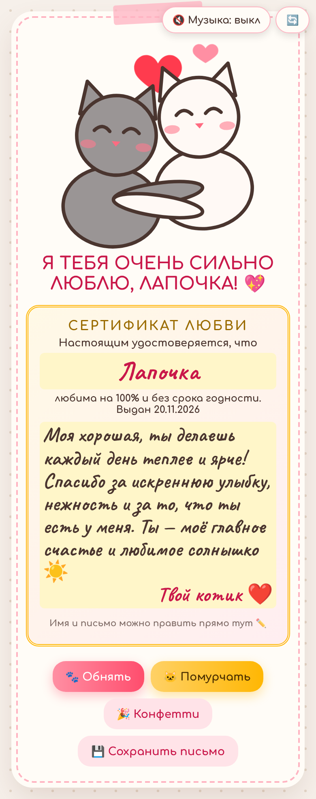
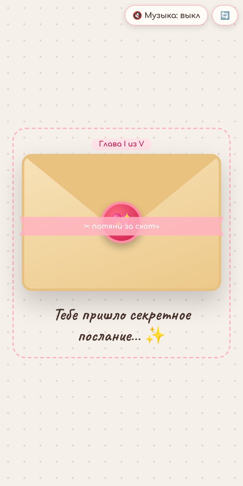
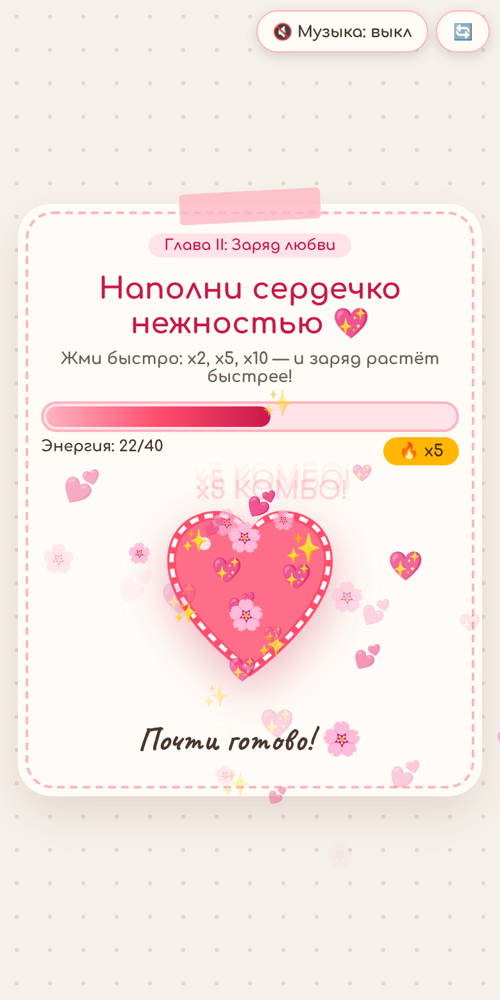
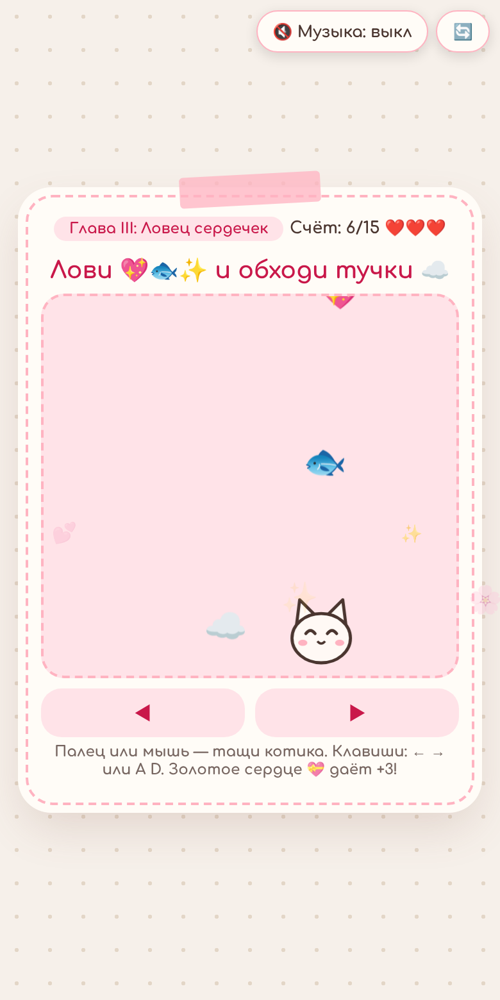
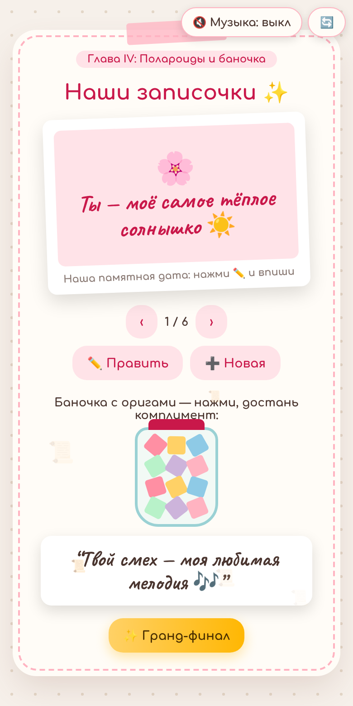
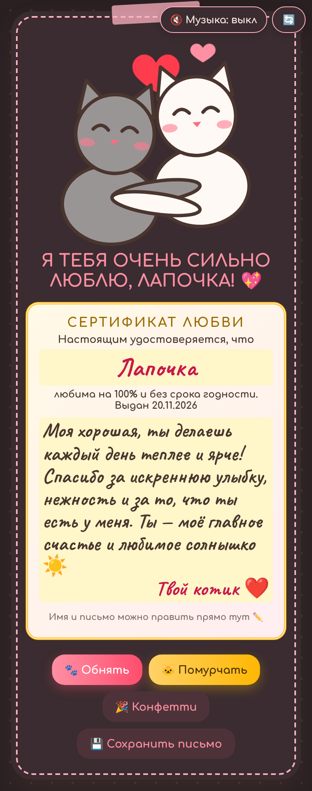

# 💌 Хроники Любви Котиков

### Интерактивная валентинка в пяти главах 💖

Сорви скотч, растопи сургучную печать, заряди сердечко, поймай пятнадцать сердечек вместе с котиком,
перебери записочки — и получи свой сертификат любви.

---

## 📸 Скриншоты

<table>
<tr>
<td align="center"> <b>I.</b> Секретное послание</td>
<td align="center"> <b>II.</b> Заряд любви</td>
<td align="center"> <b>III.</b> Ловец сердечек</td>
</tr>
<tr>
<td align="center"> <b>IV.</b> Полароиды и баночка</td>
<td align="center"> <b>V.</b> Гранд-финал</td>
<td align="center"> 🌙 Тёмная тема</td>
</tr>
</table>

## ✨ Что ждёт внутри

| Глава | Что происходит |
|---|---|
| **I. Секретное послание** ✉️ | Потяни за скотч, затем нажми на сургучную печать: она тает, и конверт открывается. |
| **II. Заряд любви** 💗 | Наполни сердечко до 40 единиц. Быстрые нажатия дают комбо x2, x5 и x10. |
| **III. Ловец сердечек** 🐱 | Мини-игра: лови 💖 🐟 ✨ и уворачивайся от тучек ☁️. Три жизни, цель — 15 очков, золотое сердце 💝 даёт +3. |
| **IV. Полароиды и баночка** 📸 | Листай записочки-полароиды, правь их и добавляй новые. Баночка с оригами выдаёт случайный комплимент. |
| **V. Гранд-финал** 🎉 | Обнимающиеся котики, признание и «Сертификат любви» с датой. Имя и письмо можно править и сохранить. |

А ещё:

- 🎵 **Музыка и звуки** — мелодия и эффекты синтезируются прямо в браузере, музыка включается кнопкой.
- 🔄 **Сброс** — кнопка в углу возвращает к первой главе.
- 🌙 **Тёмная тема** — подстраивается под настройки устройства.
- 📱 **Удобно на телефоне** — управление пальцем, вибрация, учёт «чёлки» экрана.

### Управление в мини-игре

- Палец или мышь — тащи котика по полю.
- Кнопки ◀ ▶ под полем — удерживай.
- Клавиатура — ← → или A / D.

## 💝 Как открыть

### Посмотреть на GitHub Pages

Если публикация GitHub Pages ещё не включена:

1. Открой **Settings → Pages** в настройках репозитория.
2. В разделе **Build and deployment** выбери **Deploy from a branch**.
3. Укажи ветку **main** и папку **/(root)**, затем нажми **Save**.
4. После публикации страница будет доступна по адресу  
   `https://marfaus.github.io/valentinka/`.

### Открыть на компьютере

Скачай репозиторий и открой `index.html` в браузере. Сборка и установка зависимостей не нужны.

## 🖍️ Сделать валентинку своей

**Без правки кода** — прямо на странице:

- в главе IV нажми ✏️ **Править**, чтобы изменить текст и дату полароида, или ➕ **Новая**, чтобы добавить свой;
- в финале имя в сертификате и текст письма редактируются по нажатию, а 💾 **Сохранить письмо** запоминает их и копирует текст в буфер обмена.

Изменения хранятся в `localStorage` этого браузера, на других устройствах их не будет.

**В коде** (`index.html`):

- `cards` — стартовые полароиды (эмодзи, текст, дата);
- `comp` — комплименты для баночки;
- `mel` — ноты фоновой мелодии;
- блок `#letter` и `#who` в разметке — письмо и имя по умолчанию;
- цвета задаются CSS-переменными в `:root` (`--pink`, `--red`, `--deep`, `--gold` и др.).

> Для загрузки шрифтов при открытии страницы нужно подключение к интернету. Без него валентинка работает с запасными шрифтами.

## 🏷️ Версии

Текущая стабильная версия — **v0.1**. Каждая версия отмечается git-тегом (`v0.1`, `v0.2`, …), а все изменения записываются в [`CHANGELOG.md`](./CHANGELOG.md).

## 🧰 Технологии

- Один файл `index.html`: HTML, CSS и JavaScript без сборщика и зависимостей.
- [Google Fonts](https://fonts.google.com/) — Caveat и Comfortaa.
- SVG для котиков, Canvas для частиц и конфетти.
- Web Audio API для музыки и звуков, Vibration API для отклика на телефоне.

---

Сделано с любовью, котиками и щепоткой блёсток ✨🐾

